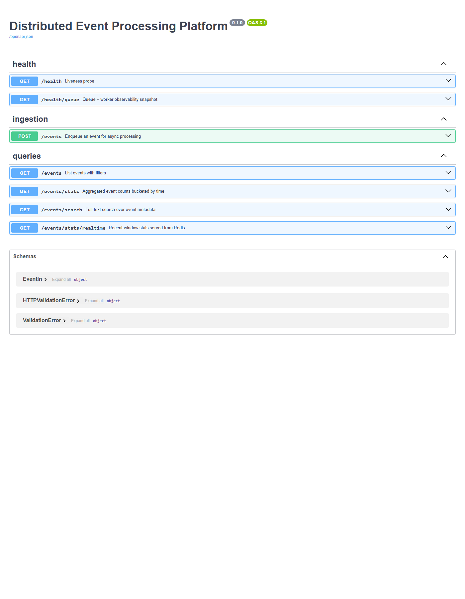

# Documentation

This directory holds the development journal for the project — one
entry per phase of work, in the order the work actually happened. The
goal is to give an interested reader (a new teammate, an ARB
reviewer, or a maintainer six months from now) a window into the
**process** behind the deliverable: what was decided, why, and how
the thinking evolved over time.

## Why split into phases?

In a typical engineering workflow, this would live as a single,
ever-growing document — an RFC that gets updated through review, or
a wiki page that accumulates context as decisions land.

For this project's hand-off, we're presenting it split into phases
so the reader can see what each step contributed:

- Some decisions were made **before any code was written** (phase 1).
- Others surfaced **during implementation** (phase 3).
- A few only became visible once the system was **exercised against
  real Mongo / Elasticsearch / Redis** (phase 5) — that phase alone
  surfaced six bugs the test suite couldn't catch, including one
  that would have silently lost data in production.

Lumping all that into a single document would flatten the timeline.
A single document shows you the **result** of the thinking. A phased
journal shows you the **order** of the thinking — which is more
useful when the goal is to understand *how* a system came together,
not just what it looks like at rest.

## Why two parallel tracks?

Each phase has two parallel documents — one for technical readers,
one for non-technical stakeholders. They cover the same decisions,
with different vocabulary.

This is intentional. A meaningful slice of platform-engineering
work is **translating engineering tradeoffs into language a product
owner, finance partner, or executive can act on**. The stakeholder
versions are an example of that translation — not a "dumbed-down"
version of the technical doc, but a translation into a different
audience's vocabulary.

## Phases

| # | Phase | When | Technical | Stakeholder |
| - | ----- | ---- | --------- | ----------- |
| 1 | Planning and project understanding | **Before any code is written** | [phase_1_planning_technical.md](phase_1_planning_technical.md) | [phase_1_planning_stakeholder.md](phase_1_planning_stakeholder.md) |
| 2 | Scaffolding and repo architecture | After planning, before behavior | [phase_2_scaffolding_technical.md](phase_2_scaffolding_technical.md) | [phase_2_scaffolding_stakeholder.md](phase_2_scaffolding_stakeholder.md) |
| 3 | Core implementation | Filling in the scaffold | [phase_3_implementation_technical.md](phase_3_implementation_technical.md) | [phase_3_implementation_stakeholder.md](phase_3_implementation_stakeholder.md) |
| 4 | Testing strategy and coverage | After the system runs end-to-end | [phase_4_testing_technical.md](phase_4_testing_technical.md) | [phase_4_testing_stakeholder.md](phase_4_testing_stakeholder.md) |
| 5 | Manual QA against the real stack | **Found 6 real bugs** | [phase_5_manual_qa_technical.md](phase_5_manual_qa_technical.md) | [phase_5_manual_qa_stakeholder.md](phase_5_manual_qa_stakeholder.md) |
| 6 | Fixes and regression hardening | Bug fixes + test count 30 → 48 | [phase_6_fixes_and_hardening_technical.md](phase_6_fixes_and_hardening_technical.md) | [phase_6_fixes_and_hardening_stakeholder.md](phase_6_fixes_and_hardening_stakeholder.md) |
| 7 | Final documentation pass | README + ARCHITECTURE polish | [phase_7_final_documentation_technical.md](phase_7_final_documentation_technical.md) | [phase_7_final_documentation_stakeholder.md](phase_7_final_documentation_stakeholder.md) |
| 8 | Code review, ARB, release, hand-off | PR + sign-offs + ops hand-off + bake-in | [phase_8_submission_technical.md](phase_8_submission_technical.md) | [phase_8_submission_stakeholder.md](phase_8_submission_stakeholder.md) |

## How to read this

If you want to see **what was built**, start with the repository's
top-level [`README.md`](../README.md) (operating manual) and
[`ARCHITECTURE.md`](../ARCHITECTURE.md) (design rationale). Those
are the deliverables proper.

If you want to see **how the work happened**, read the phase
documents here in order. They're optional context — nothing in
them is duplicated in the main deliverables — but they're how a
platform engineer should be able to walk a reviewer (or a future
maintainer) through their reasoning without re-deriving it from
the code.

### Suggested reading paths

| If you have... | Read |
| -------------- | ---- |
| 5 minutes | [`../README.md`](../README.md) |
| 20 minutes | + [`../ARCHITECTURE.md`](../ARCHITECTURE.md) |
| 40 minutes | + [phase 5 (technical)](phase_5_manual_qa_technical.md) and [phase 6 (technical)](phase_6_fixes_and_hardening_technical.md) — the highest-signal phases for understanding judgment |
| 90 minutes | + the rest of the phase docs, technical track |
| Curious about how technical decisions translate to stakeholder language | Read any phase's two versions side by side |

## Visual references

A small set of screenshots / asset references lives in
[`images/`](images/) where useful. They're not essential to
understanding the design — they're convenience captures for
readers who want a quick visual of the running system without
standing up `docker compose` themselves.

### API surface — auto-generated OpenAPI / Swagger UI

The FastAPI app serves an interactive Swagger UI at `/docs` once
the stack is up. Captured here for reference:



Surface visible in the capture:
- `GET /health`, `GET /health/queue` (health tag)
- `POST /events` (ingestion tag) — the 202-Accepted async ingest path
- `GET /events`, `GET /events/stats`, `GET /events/search`,
  `GET /events/stats/realtime` (queries tag)
- Schemas: `EventIn`, `HTTPValidationError`, `ValidationError`

To regenerate this asset locally:

```bash
docker compose up -d
# then point any headless browser at http://localhost:8000/docs
```
